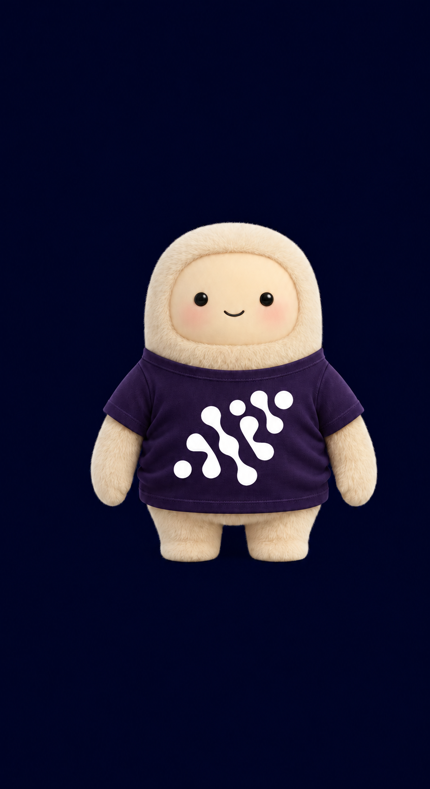

# AIP Restyle

Apply the **AI Pioneers / رواد الذكاء الاصطناعي** palette and emblem to images and designs while preserving their subject, text, layout, and style.

**Members only:** Installation, use, and sharing are restricted to current AI Pioneers members. See the [license](LICENSE).

<p>
  
  
</p>

## Install

With Node.js and npm installed, run this from your project directory:

```bash
npx skills add https://github.com/Sl-15-dev/aip-restyle/tree/main --skill restyle-ai-pioneers --agent codex
```

Add `--global` to use it across projects, or omit `--agent codex` to choose another supported agent. Reload skills or start a new agent session after installation.

## Use

Attach your image or editable design and ask your agent:

```text
Use $restyle-ai-pioneers on this image. Apply the AIP palette, preserve the
subject and original text, and integrate the emblem into a suitable surface.
Keep the original dimensions and transparency.
```

For a specific logo placement:

```text
Use $restyle-ai-pioneers on this character. Make the T-shirt dark purple
and place the white AIP emblem on its chest. Preserve the face and pose.
```

Your agent needs an image-editing tool for raster edits. For editable output, provide the editable source and specify the format you want.

## Options

Include these preferences in your prompt:

| Option | Choices | Default |
| --- | --- | --- |
| Strength | `subtle`, `balanced`, `bold` | `balanced` |
| Theme | Keep the source, use light, or use dark | Keep the source |
| Logo | `auto`, `required`, `none` | `auto` |

Name the surface when placement matters, such as a shirt or laptop lid. Use `logo: none` to omit the emblem.

## Resources

- **Palette:** [JSON](assets/palette.json), [CSS](assets/palette.css), [SVG](assets/palette.svg), and [PNG](assets/palette.png).
- **Emblem:** [SVG and transparent PNG variants](assets/logos/README.md).
- **Guides:** [Brand identity](references/brand-identity.md), [edit recipes](references/edit-recipes.md), and [logo placement](references/logo-workflow.md).

The optional [logo helper](scripts/brand_image.py) requires Python 3.10+ and [Pillow](requirements.txt). It places the exact bundled emblem on simple, front-facing surfaces; see the logo placement guide for commands.
